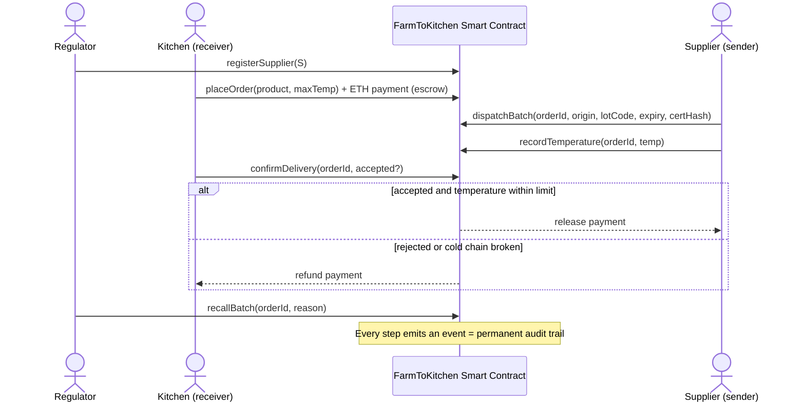

# Analysis & Design – Farm-to-Kitchen Food Traceability on Blockchain

> Working notes for Task 1 (40%). The poster will use a condensed version (max. 700 words).

## 1. Personal Motivation

I have been working in a professional kitchen for two years, and I see many opportunities for automation and improvement in traceability, stock control, document storage and the overall organisation of the section.

Improving these processes brings reliability, which makes a strong impression during audits and management reviews. Most importantly, it supports compliance: keeping documents in order, having the system record temperature readings automatically, and rejecting products that arrive outside the target range.

_<Write 3–4 lines in your own words: what you see in the kitchen when deliveries arrive –
paper delivery dockets, temperature checks, allergen labels, what happens when a supplier
recalls a product. This is the hook for the poster and the video.>_

## 2. The Problem – How Food Traceability Works Today

- **Legal baseline (EU / Ireland):** Regulation (EC) No 178/2002 requires every food business
  to identify its immediate supplier and immediate customer – the _"one step back, one step
  forward"_ approach (FSAI, n.d.; EUFIC, n.d.).
- **In practice:** paper delivery dockets, handwritten HACCP temperature logs, spreadsheets and
  separate ERP systems at each company. Each business sees only its own link of the chain.
- **Consequences:**
  - Slow trace-back during an outbreak or recall – Walmart needed **almost 7 days** to trace a
    pack of sliced mangoes to its farm using traditional records (LF Decentralized Trust, n.d.).
  - Records can be lost, altered or falsified (e.g. the 2013 horsemeat scandal, first detected
    by the FSAI in Ireland).
  - Over-broad recalls and food waste, because nobody can isolate the exact affected batch.
- **Regulatory pressure is increasing:** in the US, the FDA Food Traceability Rule (FSMA 204)
  requires electronic traceability records for high-risk foods; its compliance date was moved
  from January 2026 to **20 July 2028** (FDA, 2025).

## 3. Proposed Solution – "FarmToKitchen" DApp

A smart contract on Ethereum acts as the **trusted middle layer** between a **supplier (sender)**
and a **restaurant kitchen (receiver)**. It records every batch of food and holds the payment
in escrow until the kitchen confirms the delivery meets the agreed conditions.

### 3.1 Actors

| Actor                                              | Role in the contract                                                                                                  |
| -------------------------------------------------- | --------------------------------------------------------------------------------------------------------------------- |
| **Regulator / Admin** (e.g. food-safety authority) | Deploys the contract, registers trusted suppliers, can issue a **recall** on a batch                                  |
| **Supplier – sender**                              | Registers a batch (product, origin, lot code, expiry, certificate hash), dispatches it, records transport temperature |
| **Restaurant kitchen – receiver**                  | Places an order and deposits payment, inspects the delivery, **accepts** (payment released) or **rejects** (refund)   |
| **Anyone** (customer, inspector)                   | Reads the full, tamper-proof history of a batch (e.g. via a QR code on the menu)                                      |

### 3.2 Batch life cycle

```
Ordered → Dispatched → Delivered → Accepted ──► payment to supplier
                                  └► Rejected ──► refund to kitchen
            (at any time) ──► Recalled by regulator
```

### 3.3 Sequence diagram (UML)



### 3.4 Smart contract features (to implement – Task 2)

- `struct Batch` + `enum Status` to model the life cycle
- Role checks with `modifier` (`onlyRegulator`, `onlySupplier`, `onlyKitchen`)
- `payable` escrow: funds locked in the contract, released only by the rules
- `event`s for every step (audit trail visible in Remix / Ganache)
- `bytes32 certificateHash` – Keccak-256 hash of the supplier's certificate stored off-chain
- `getBatch()` view function for public traceability

## 4. Business Model & Disruptive Influence

| Today                                          | With blockchain                                 |
| ---------------------------------------------- | ----------------------------------------------- |
| Each company keeps its own records (silos)     | One shared, synchronised ledger for all parties |
| Trust depends on the supplier's word / paper   | Trust enforced by code and cryptography         |
| Recall = phone calls and paper searches (days) | Trace-back in seconds (Walmart: 7 days → 2.2 s) |
| Payment terms of 30–60 days, disputes          | Automatic escrow payment on accepted delivery   |
| Records can be edited after the fact           | Records are immutable and time-stamped          |

**Revenue model (consortium platform):** suppliers and restaurants pay a small subscription or
per-batch fee; regulators get read access free; restaurants can market "verified provenance"
dishes to customers (QR code on the menu) – turning compliance into a selling point.

**Disruption:** removes intermediaries in auditing and payment reconciliation, shifts
traceability from "one step back, one step forward" to **end-to-end visibility**, and moves
recalls from batch-guessing to precise, targeted withdrawals that reduce food waste.

## 5. Recent Advancements Incorporated

- **Layer-2 rollups** (e.g. Arbitrum, Optimism, Base): after Ethereum's Dencun upgrade
  (EIP-4844, 2024) transaction fees on L2 dropped sharply, making per-batch records affordable.
- **IoT sensors + oracles** (e.g. Chainlink): temperature loggers in delivery vans can push
  readings on-chain automatically instead of manual entry.
- **GS1 EPCIS 2.0 / lot codes:** a global data standard so different companies' systems interoperate.
- **Zero-knowledge proofs (future work):** prove "the cold chain was respected" without revealing
  commercially sensitive data such as prices or supplier lists.

## 6. Benefits and Challenges

**Benefits:** transparency, immutability, faster recalls, less food waste, automatic payments,
fewer disputes, easier compliance and inspections, consumer trust.

**Challenges:**

- _Garbage in, garbage out_ (oracle problem) – blockchain cannot verify that the physical food
  matches the data entered; IoT sensors and audits are still needed.
- Adoption by small suppliers (cost, digital skills, internet access).
- Transaction cost and scalability on public chains (mitigated by L2).
- Privacy of commercial data on a public ledger.
- **GDPR vs immutability** – no personal data should be stored on-chain.
- Interoperability between different blockchain platforms and existing ERP systems.

## 7. Cryptographic Method

**Chosen approach: ECDSA digital signatures (secp256k1) + Keccak-256 hashing.**

1. **ECDSA (Elliptic Curve Digital Signature Algorithm)** – every transaction (dispatch, delivery
   confirmation, recall) is signed with the sender's private key. This gives:
   - _Authentication_ – only the registered supplier can dispatch a batch;
   - _Non-repudiation_ – the supplier cannot later deny recording a temperature or a lot code;
   - _Integrity_ – any change to a signed transaction invalidates the signature.
     In Solidity this appears as `msg.sender`, which the network derives from the signature.
2. **Keccak-256 hashing** – certificates (organic, allergen, lab results) are too large to store
   on-chain. The file stays off-chain (e.g. IPFS) and only its 32-byte hash goes on-chain.
   If anyone alters the document, its hash no longer matches → tampering is detected.
   Blocks are also chained by hashes, so altering an old record would break every later block.

**Why this is the most suitable method:** traceability needs _proof of who recorded what and
proof that it was not changed afterwards_ – exactly what digital signatures and hashing provide,
at low cost and natively supported by Ethereum. Encryption alone would hide data but would not
prove origin or integrity.

## 8. References (Harvard)

- EUFIC (n.d.) _Food traceability: cornerstone of EU food safety policy_. Available at:
  https://www.eufic.org/en/food-production/article/food-traceability-cornerstone-of-eu-food-safety-policy
  (Accessed: 11 November 2026).
- FDA (2025) _FSMA Final Rule on Requirements for Additional Traceability Records for Certain Foods_.
  Available at: https://www.fda.gov/food/food-safety-modernization-act-fsma/fsma-final-rule-requirements-additional-traceability-records-certain-foods
  (Accessed: 11 November 2026).
- FSAI (n.d.) _General Principles of Food Law_. Available at:
  https://www.fsai.ie/Enforcement-and-Legislation/Legislation/Food-Legislation/General-Principles-of-Food-Law
  (Accessed: 11 November 2026).
- LF Decentralized Trust (n.d.) _Case Study: How Walmart brought unprecedented transparency to the
  food supply chain with Hyperledger Fabric_. Available at:
  https://lfdecentralizedtrust.org/case-studies/walmart-case-study (Accessed: 11 November 2026).
- Nakamoto, S. (2008) _Bitcoin: A Peer-to-Peer Electronic Cash System_. Available at:
  https://bitcoin.org/bitcoin.pdf (Accessed: 11 November 2026).
- Wood, G. (2014) _Ethereum: A Secure Decentralised Generalised Transaction Ledger_. Available at:
  https://ethereum.github.io/yellowpaper/paper.pdf (Accessed: 11 November 2026).
